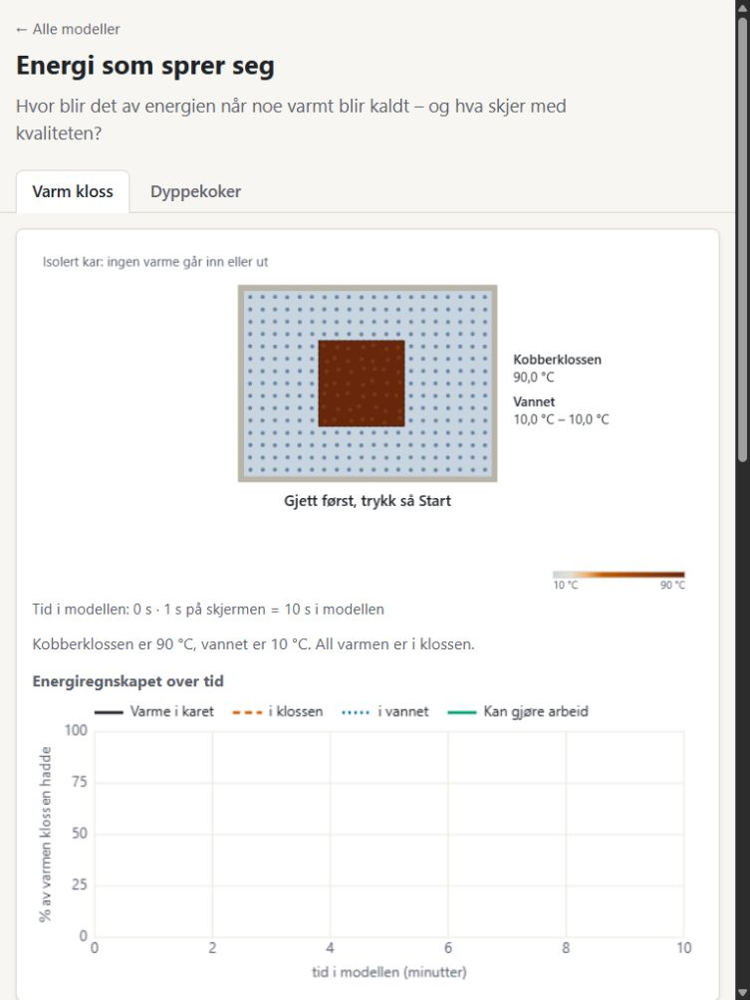

# Didaktisk og visuell gjennomgang

24. oktober 2026. Vurdering av arbeidskopien, inkludert de eksisterende endringene i felles gjetningskomponent og fokusfarge.

**Hovedvurdering:** Prosjektet har en gjennomarbeidet teknisk og faglig grunnstruktur. Den viktigste forbedringen nå er å gjøre elevens observasjon og forklaring like gjennomarbeidet som beregningene. Særlig energispråket, oppsettet på nettbrett og snømodellens observasjonstid bør forbedres før selvstendig elevbruk.

Dette er en ekspertvurdering og funksjonsprøving, ikke dokumentasjon av læringseffekt hos elever. Modellkoden er ikke endret i denne gjennomgangen.

## Hva som er laget

| Del | Status og vurdering |
|---|---|
| Varmeledning med partikler | To forsøk: berøring og isbit på kloss. Den tydeligste koblingen mellom hverdagsopplevelse, temperatur og retning på varmeoverføring. |
| Overflate og volum | Snø som blokk, oppdelt eller spredt. Luft, sol og underlag. Bevarer tidligere kurver, noe som gir et godt grunnlag for sammenligning. |
| Energi som sprer seg | Varm kobberkloss og dyppekoker. Synkroniserte temperaturbilder, energisøyler og grafer. Faglig ambisiøs, men med størst behov for begrepsavklaring. |
| Felles grunnlag | Varmemotor, materialdata, partikkelvisning, graf, gjetning, tekstbeskrivelser, tastaturkontroller og grensesnitt for en framtidig KI-tutor. Selve tutoren er ikke implementert. |
| Deling og videreutvikling | Katalog, tre lærerveiledninger, mal for nye modeller, lokal server og verktøy for selvstendige HTML-filer. Ingen samfunnsfagmodeller ennå. |

**Behold:** Rolig utseende, store vanlige knapper, bokmål, temperatur også som tall, strektyper i flere grafer, gjetning ved siden av resultat, eksplisitte forenklinger, offline-arkitektur og skillet mellom fysikk og tegning.

De sentrale læreplankoblingene til energibevaring, energikvalitet, utforsking og modellkritikk stemmer med [naturfag etter 10. trinn, NAT01-05](https://www.udir.no/lk20/nat01-05/kompetansemaal-og-vurdering/kv1078). Det er særlig elevens bruk av observasjoner til å lage forklaringer som kan styrkes i selve modellene.

## Det viktigste å forbedre

### 1. Rett energispråket før elevtesting

**Prioritet: høy. Bekreftet i elevtekst og kode.**

Under «Hva betyr kan gjøre arbeid?» står det at energi bare kan gjøre noe nyttig når den strømmer fra varmt til kaldt. Det er ikke riktig om energi generelt: eksempelvis kan en fallende gjenstand gjøre arbeid uten at dette krever en temperaturforskjell. Beregningen i modellen gjelder et avgrenset spørsmål: maksimalt arbeid fra temperaturforskjellene *inne i karet*.

«Ingenting» som fasit i dyppekokerforsøket og katalogens «hvorfor kan vi ikke bruke den igjen?» blir derfor for generelle. Vann kan fortsatt avgi energi til noe kaldere utenfor karet. Det betyr ikke at modellens beregnede nullverdi er feil; det betyr at systemgrensen må inngå i forklaringen.

Modellen bruker dessuten «Varme i karet», «varmen klossen hadde» og «all varmen er i klossen». Regnemotoren fører i realiteten et regnskap over energi **utover nivået ved 10 °C**. Vannet starter på 0 prosent i dette regnskapet, men er ikke uten indre energi. Varme betegner energi som overføres på grunn av temperaturforskjell; det lagrede er indre energi. Dette skillet beskrives også i [OpenStax, Thermal Energy and Work](https://openstax.org/books/physics/pages/12-2-first-law-of-thermodynamics-thermal-energy-and-work).

**Konkret forslag:**

- Skriv «Energi vi følger» og forklar kort: «Vi følger energien utover nivået ved 10 °C. Vannet hadde også energi fra før.»
- Avgrens arbeidstallet: «Arbeid fra temperaturforskjellene i karet». Forklar: «Når alt i karet har samme temperatur, kan en varmekraftmaskin ikke hente mer arbeid fra disse forskjellene.»
- Bytt «bare 5,2 % igjen» i dyppekokerens sluttforklaring til «5,2 % kunne fortsatt bli arbeid i denne modellen». Behold 100 prosent energi synlig samtidig.
- Vis hvor energien som ennå ikke er tilført dyppekokeren, regnes med. «Som strøm» og «Strøm på – 100 % igjen» mangler en synlig energikilde. Bruk for eksempel «Elektrisk energi som skal tilføres», og marker energitilførselen over karets grense. «Varmeisolert» er tydeligere enn bare «isolert» her.

**Godt nok når:** Eleven kan forklare både hvorfor 100 prosent energi er igjen, hvorfor arbeidstallet blir null, og at nullverdien gjelder akkurat dette systemet.

Kode: `modeller/naturfag/energi-som-sprer-seg/index.html:92`, `kontroller.js:39–100`, `modell.js:127–173`, `visning.js:136–178`.

[Skjermbilde av energiforklaringen](energi-arbeid-forklaring.png)

### 2. Samle gjetning, start og observasjon på skjermen

**Prioritet: høy. Målt i nettleseren.**

Ved bredder under 860 piksler legges hele scenen, statusen og grafen før hele kontrollpanelet. Dette er responsivt i betydningen at innholdet får plass i bredden, men rekkefølgen passer dårlig til forsøket.

I energimodellen ved **768 × 1024** begynte gjetningsboksen omtrent 1042 piksler ned på siden og Start-knappen ved 1574 piksler, før gjetningen var låst. Eleven ser først en modell som sier «Gjett først», uten å se valgene. Etter å ha rullet til og trykket Start er animasjonen utenfor skjermen. Snømodellen hadde samme problem: gjetningen ved omtrent 1016 piksler og Start ved 1603 piksler.

Også ved **1366 × 768** lå varmeledningsmodellens Start-knapp under første skjerm før gjetning, omtrent ved 799 piksler. Grafen begynte ved 732 piksler. Låsing forkorter gjetningsboksen og hjelper, men innholdet flytter seg samtidig.

**Konkret forslag:** Del siden i mindre områder som kan ordnes etter elevens oppgave: et kompakt gjetningssteg, scene med Start/Pause tett på, nøkkeltall, graf og forklaring. På nettbrett må Start og selve forsøket kunne ses sammen. Plasser den omfattende tabellen og sekundære forklaringer lenger ned. Det kan gjøres med eksisterende HTML og CSS.

**Godt nok når:** En elev på 768 × 1024 kan finne gjetningen, starte og se den første viktige hendelsen uten å lete eller rulle under oppstart.

Kode: `felles/stil.css:101–129` og rekkefølgen mellom scene og panel i modellenes HTML.

### 3. La eleven rekke å se hvorfor hjørnene smelter først

**Prioritet: høy. Bekreftet med nettleser og separat kjøring av fysikken.**

Snømodellen spør hvor smeltingen begynner, men standardfarten er én time i modellen per sekund på skjermen. Med bare luft når hjørnene 0 °C etter **720 sekunder**, mens midten av sidene når 0 °C etter **2420 sekunder**. Med den innstilte farten tilsvarer dette omtrent **0,20 og 0,67 sekunder** på skjermen, når maskinen holder ønsket fart.

Fasiten kommer dermed før eleven normalt rekker å orientere seg. Dette blir særlig uheldig når eleven samtidig må rulle tilbake til animasjonen. Den første smeltingen er også et svært lite område i en relativt liten snøblokk, og grafen viser total smelting, ikke forskjellen mellom hjørne og sidemidt.

**Konkret forslag:** Gi første del av forsøket et eget rolig observasjonsforløp. Marker én hjørnecelle og én celle midt på siden, med temperatur og varme inn fra sidene. Stopp gjerne ved første 0 °C og la eleven beskrive forskjellen før en kan fortsette raskt til all snø er smeltet. En forstørret detaljrute kan vise hjørnet uten å endre størrelsesforholdet mellom blokkene.

**Godt nok når:** Eleven kan peke på en konkret forskjell i bildet før forklaringen vises, og sammenholde den med målingene.

Kode: `modeller/naturfag/overflate-og-volum/kontroller.js:48`, `177–193` og `321–326`; `modell.js:114–156`.

### 4. Gjør snittet og de tredimensjonale tallene til en sammenhengende fortelling

**Prioritet: høy for kvantitativ bruk. Bevisst forenkling med en konkret inkonsistens.**

Valget «4 biter» viser fire biter, mens tallpanelet sier «8 terninger». Ved «64 biter» står det 512 terninger. Forklaringen om snitt finnes, så dette er ikke en skjult antakelse. Men eleven må forstå snitt, tredimensjonal oppdeling og forholdet mellom overflate og volum samtidig.

For «spredt utover» er det mer enn to måter å vise samme gjenstand på: fysikken bruker et **64 × 4 cm snitt**, mens tabellen beregner en **32 × 32 × 4 cm plate**. Tabellen viser 1,67 ganger så stort overflate/volum-forhold som terningen; det tilsvarende forholdet mellom omkrets og areal i de simulerte snittene øker med 2,125. Disse tallene beskriver ulike geometrier.

Massen 1,7 kg i tabellen gjelder også terningen i tre dimensjoner, mens regnemotorens 1 cm tykke snitt inneholder omtrent 0,108 kg. Det er i seg selv legitimt å regne på et snitt, men tallene må ikke framstå som ett og samme direkte simulerte objekt.

**Konkret forslag:** Bestem hva eleven skal sammenligne i hovedforsøket. Behold gjerne den enkle snittmodellen, men merk den som snitt og gjør «Terninger i tre dimensjoner» til en tydelig, separat fordypning. Alternativt må geometri, betegnelser og varmeutveksling gjøres konsistente for den tredimensjonale gjenstanden. Det er ikke nødvendig å innføre en tung 3D-visning.

**Godt nok når:** Eleven kan svare på hvor mange biter forsøket gjelder, hvilken masse og form tallene beskriver, og hvilke tall som faktisk forklarer den viste kurven.

Kode: `modeller/naturfag/overflate-og-volum/modell.js:16–79`, `kontroller.js:71–100` og `199–204`.

[Skjermbilde: fire biter og åtte terninger](sno-fire-biter-atte-terninger.png)

### 5. Fullfør «forutsi–observer–forklar» i elevvisningen

**Prioritet: middels til høy. Didaktisk vurdering, ikke målt elevatferd.**

Gjetningen lagres og vises ved resultatet, men eleven blir ikke bedt om en begrunnelse i selve modellen. Etter forsøket leverer modellen forklaringen. Varmeledningsforsøket viser den allerede etter to simulerte sekunder. Lærerveiledningene inneholder langt bedre forklaringsoppgaver enn elevsidene gjør.

Risikoen er et forløp med valg, avspilling og lesing av fasit, der elevens opprinnelige årsaksforklaring ikke blir synlig. Et riktig alternativ viser heller ikke nødvendigvis at eleven har forstått mekanismen.

**Konkret forslag:** Legg inn korte oppfordringer som kan besvares muntlig eller på papir: «Jeg tror dette fordi …», «Hvilken måling støtter forklaringen din?» og «Hva ville skjedd hvis …?». Vis resultat og observasjoner først; la modellforklaringen kunne åpnes etterpå. Behold kravet om en gjetning før Start, og unngå mange obligatoriske skrivefelt.

Et godt eksempel i varmeledning: «Begge klossene startet på 20 °C. Hvilken temperatur endret seg mest: klossens eller hudens? Hvordan forklarer det det du kjenner?»

Anbefalingen er inspirert av sammenhengen mellom utforsking, representasjoner og tilbakemelding i [PhET-studien til Podolefsky, Perkins og Adams (2010)](https://phet.colorado.edu/publications/prst-per-2010.pdf). Studien undersøkte studenter og en annen simulering; den dokumenterer ikke effekten av dette konkrete forslaget på norske ungdomsskoleelever.

Kode: `felles/js/forutsi.js:55–154`, varmeledningsmodellens `kontroller.js:199–215`.

### 6. Gjør partiklene til en tydelig representasjon, ikke et bokstavelig atomtall

**Prioritet: middels.**

I energimodellens sluttforklaring står det at energien er spredt fra 49 til 300 partikler. Dette er antall beregningsceller. Hver celle representerer et lite volum stoff, med ulik varmekapasitet i vann og kobber. Prikkene er ikke en telling av virkelige partikler.

Vannet tegnes dessuten som et regelmessig rutenett av partikler som vibrerer rundt faste plasser, omtrent som et fast stoff. «Vannet står helt stille» forklarer at modellen utelater strømning i vannet, men forklarer ikke alene denne forskjellen mellom tegningen og molekylbevegelsen i en væske.

**Konkret forslag:** Fjern de bokstavelige partikkeltallene fra årsaksforklaringen. Skriv at energien fordeles over mer stoff, og forklar nær scenen at prikkene er en forenklet framstilling av små stoffområder. Dersom de skal representere molekyler, må også bevegelsen og begrensningene kommuniseres tilsvarende. Legg få tydelige piler fra varmt mot kaldt til energiscenen; fargeendring alene viser ikke overføringen like tydelig som pilene i berøringsforsøket.

Kode: energimodellens `kontroller.js:62`, `visning.js:30–39` og `modell.js:59–62`.

### 7. Gi grafer og tall en tydeligere lesestøtte

**Prioritet: middels.**

På en skjermbredde på 390 piksler blir energiscenens lerret omtrent 309 piksler bredt. Tekst tegnet som 15 piksler i et 760 piksler bredt lerret vises da med omtrent 6 pikslers høyde. Vanlig sidetekst er fortsatt stor, så forskjellen i lesbarhet blir svært tydelig.

Grafen i energimodellen viser samtidig total energi, energifordeling og mulig arbeid på samme prosentakse. Når tidsaksen utvides underveis, presses de første minuttene sammen. Det er nettopp der mye av endringen eleven skal forklare, skjer.

**Konkret forslag:** Flytt viktige navn og temperaturer til vanlig tekst som beholder lesbar størrelse. La grafen følge tilgjengelig bredde uten at alle bokstaver krymper. Marker sentrale hendelser og tilby en enkel visning av de første minuttene. Vis først energifordelingen; innfør arbeidstallet som neste spørsmål. En liten tabell med start, nøkkelhendelse og slutt hjelper både avlesing og tilgang uten å se grafen.

Tekstbeskrivelser og tastaturstøtte er allerede et godt utgangspunkt. En ekte skjermleserprøve gjenstår; gjennomgangen dokumenterer ikke full tilgjengelighet.

Kode: `felles/js/lerret.js:6–19`, `felles/js/graf.js:36–56` og `142`; energimodellens `kontroller.js:168–177`.

[Skjermbilde av liten tekst i lerretet](energi-smal-skjerm.png)

### 8. Stram inn første oppgave og dokumentasjonen

**Prioritet: middels.**

Alle tre lærerveiledningene lister flere misoppfatninger. Det er verdifullt som lærerbakgrunn, men hovedskjermen kan få ett tydelig mål om gangen. I snømodellen konkurrerer hjørnesmelting, oppdeling, sol, underlag, overflate og volum om oppmerksomheten. I energimodellen kommer bevaring og energikvalitet samtidig.

**Foreslått første møte:**

| Modell | Første spørsmål | Neste utforsking |
|---|---|---|
| Varmeledning | Hvorfor kjennes like varme klosser forskjellige? | Overfør forklaringen til isbit, flisgulv og teppe. |
| Snø | Hvor begynner én blokk å smelte? | Sammenlign oppdeling med samme varmekilder; sol og underlag kan ligge under «Mer». |
| Energi | Hvor havner energien fra klossen? | Undersøk deretter hva temperaturforskjellene kan brukes til, og sammenlign med dyppekoker. |

Dokumentasjonen trenger også to konkrete rettelser:

- Varmeledningsmodellens README, linje 81, sier at smeltevannet blir liggende. Elevsiden og koden sier at det renner bort. Dette påvirker varmeoverføringen og er derfor mer enn en skrivefeil.
- Flere materialverdier har bare «standard tabellverdi» som kilde. Gi etterprøvbar referanse med tabell eller side, materialtype og relevante temperaturbetingelser. Dette er en mangel ved sporbarheten, ikke dokumentasjon på at tallene er feil.

## Hva jeg faktisk prøvde

- Leste prosjektregler, oversikt, hovedplan, designprinsipper, alle tre lærerveiledningene, sentrale modell-, visnings- og kontrollfiler samt felles støttefiler og materialdata.
- Kjørte `node --test`: **58 tester bestått, 0 feil**, omtrent 24 sekunder. Testene omfatter blant annet energibevaring, likevekt, smelteplatå, materialrekkefølge, oppdeling og pakking til enkeltfiler.
- Prøvde gjetning, låsing, start, pause, fortsettelse, nullstilling, faneskifte, materialvalg, oppdeling og fartsvalg i nettleseren.
- Fulgte isbitforsøket til begge var smeltet, snø med én blokk og fire biter til slutt, og både varm kloss og dyppekoker til termisk likevekt. Varm kloss endte på omtrent 21,1 °C og dyppekoker på 20,8 °C med middels vannmengde.
- Bekreftet at tidligere snøkurver beholdes ved sammenligning. Ingen feil eller advarsler kom fram i de tre kontrollerte modellenes konsolllogger.
- Inspiserte vanlig PC-visning, nettbrettformat 768 × 1024 og smal visning 390 × 844. Skjermstørrelsene er etterlignet i en stasjonær nettleser; dette er ikke en test av faktisk iPad-maskinvare eller Safari.
- Regnet separat på tidspunktet for snøens første 0 °C og på forskjellen mellom geometrien i simuleringen og tallpanelet.

**Ikke verifisert her:** læringseffekt med elever, ytelse på fysisk billig Chromebook, VoiceOver/NVDA, full tilgjengelighetsstandard eller åpning av de eksporterte filene ved dobbeltklikk uten nett. Pakketestene består, men dette erstatter ikke den siste brukstesten.

## Foreslått rekkefølge for neste arbeid

1. Rett energispråk og utdatert lærerveiledning. Gjør referansenivå og systemgrense tydelige. Vis og vurder teksten før større ombygging.
2. Forbedre det felles oppsettet på nettbrett og avspillingen av snøens første smelting. Prøv én modell først og bruk erfaringen i de andre.
3. Avklar snømodellens geometri før videre arbeid med de kvantitative tallene. Behold eksisterende fysikktester og legg til en kontroll som knytter geometrien i tallpanelet til det forsøket skal representere.
4. Prøv et kort undervisningsforløp med noen få elever som tenker høyt. La dem finne gjetningen, peke på observasjonen, begrunne resultatet og bruke forklaringen i en ny situasjon. Registrer hvor de trenger lærerhjelp, ikke bare om de velger riktig alternativ.

Et egnet første elevforsøk er varmeledningsmodellen: berør to materialer i rommet, forutsi resultatet i modellen, sammenhold hudtemperatur og varmestrøm, og forklar deretter hvorfor en isbit kan smelte raskest på materialet som kjennes kaldest.
