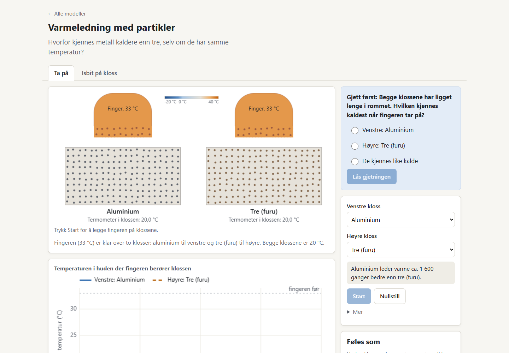
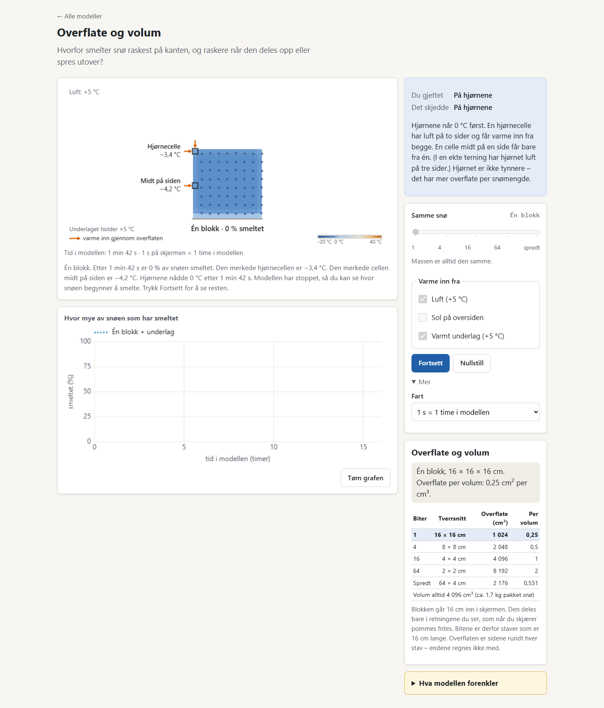
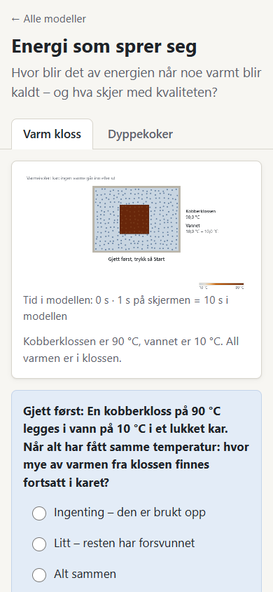

# Modellgjennomgang

**29.10.2026.** Gjelder de tre modellene ved revisjon `8958ff8`. Dette er en faglig og teknisk revisjon med faktiske nettleserprøver, ikke en evaluering av dokumentert elevlæring.

## Hvordan vurderingene skal leses

Funn skilles i **D: dokumentert feil**, **M: potensielt misvisende forenkling**, **U: usikkerhet som krever videre vurdering**, og **P: pedagogisk forbedringsmulighet**. En korrekt beregning kan fremdeles gi en feil forklaring. P1/P2 viser prioritet, ikke hvor sikker observasjonen er.

Skalaen nedenfor er et begrunnet revisjonsskjønn: 1 = vesentlig svikt, 2 = betydelige barrierer, 3 = brukbar med støtte og forbedringer, 4 = sterk innen oppgitt ramme, 5 = særlig gjennomarbeidet og bredt validert. Det finnes ikke grunnlag for 5 i samlet kvalitet før elev- og enhetsprøving.

| Modell | Faglig kvalitet | Pedagogisk verdi | Visuell tydelighet | Interaktivitet | Teknisk kvalitet |
|---|---:|---:|---:|---:|---:|
| Varmeledning med partikler | 4 | 4 | 3 | 4 | 4 |
| Overflate og volum | 3 | 4 | 3 | 4 | 4 |
| Energi som sprer seg | 3 | 3 | 3 | 3 | 4 |

Snømodellens fagscore trekkes ned av et bekreftet avvik mellom temperatur, markør og forklaring. Energimodellens fysikk er bedre enn fagscoren alene antyder; elevspråket og abstraksjonsnivået trekker ned. Ingen gjennomsnittsscore brukes til å skjule slike forskjeller.

## Utførte funksjonsprøver

| Område | Varmeledning | Snø | Energi |
|---|---|---|---|
| Start sperret før låst gjetning | Prøvd | Prøvd | Prøvd |
| Innganger og yttergrenser | Alle seks materialer i begge menyer; like materialer; saktevalg | Alle fem oppdelinger; sol og underlag av/på, også sammen | Alle tre vannmengder ved 40 og 90 °C; gliderens Home/End |
| Avanserte valg | Alle fire isbitfarter; «Mer» og forenklinger | Alle tre hastigheter | Alle tre hastigheter; joulevisning, forklaring og forenklinger |
| Start, pause, fortsett, nullstill | Begge faner; fysikktid står i pause | Auto- og manuell pause; videre kjøring; ny gjetning ved nullstilling | Begge faner; pause og nullstilling |
| Fullførte løp i nettleser | Berøring til 20 s; is på aluminium til første smelting | 64 biter og spredt + sol + underlag til slutt; én blokk til observasjonspause | Varm kloss til likevekt; dyppekoker til strøm av og senere likevekt |
| Sammenligning | To samtidige materialer; gjetning/resultat | To gjennomførte kurver beholdt; «Tøm graf» prøvd | Fanebytte prøvd; dette starter et nytt løp, ingen vedvarende sammenligningsgraf |
| Tastatur | Radio, lås, start, fanepiler | Standardkontroller og fokusrekkefølge undersøkt | Radio, lås, start, glider, Home/End på faner |
| Touch | Radio/lås/start på emulert nettbrett | Samme | Samme |
| Uten nett | Eksisterende og generert enkeltfil startet | Samme | Samme |

Dette er **ikke** alle kombinasjoner av materialer, fart, skjerm og innbaking. Isbiten på tre ble ikke kjørt helt til slutt i nettleseren. Fysikktestene undersøker isløpet videre og temperaturgrensen, men erstatter ikke en full prøve av sluttgrensesnittet. Kontrast og fokus ble undersøkt med utvalgte målinger; skjermleseropplevelsen er ikke prøvd med faktisk hjelpemiddel.

Hovedresultater: [nettleserresultater.json](nettleserresultater.json). Tillegg med redusert bevegelse før innlasting, fokusrekkefølge, mal og is: [tillegg-nettleser.json](tillegg-nettleser.json). Ett feil fanenavn i første kjøring av tilleggsskriptet ble korrigert; det var en feil i revisjonsverktøyet, ikke i modellen.

## 1. Varmeledning med partikler

[Modell og lærerveiledning](../../modeller/naturfag/varmeledning-partikler/README.md).

### Læringsidé og undervisning

Det sentrale er forskjellen mellom en gjenstands temperatur og det hånden opplever når energi overføres. Eleven trenger en enkel forståelse av temperatur og retning på varmeoverføring. To materialer starter på samme temperatur; fingrene starter varmere. Isbiten gir et godt nytt spørsmål: materialet som kjennes kaldt, kan samtidig smelte is raskt.

Dette er den sterkeste eksisterende modellen fordi den kobler en kjent sanseerfaring til et skjult fenomen. Samtidig visning, kurver med ulike linjetyper og gjetningen ved siden av resultatet bør beholdes. Start med aluminium/tre. Seks materialer er nyttig fri utforsking etter den første sammenligningen, men bør ikke være seks nye oppgaver i introduksjonen.

Forslag til 15–20 minutter: Elevene kjenner på to romtempererte gjenstander, forutsier individuelt og begrunner i par. Læreren bekrefter med termometer at starttemperaturene er like. Kjør modellen, stopp tidlig og følg energi fra finger til kloss. La elevene forutsi isbitforsøket før fanebytte. Avslutt med en ny situasjon, for eksempel metall og tre som begge er varmere enn hånden. Modellen skal støtte forklaring, ikke erstatte den fysiske erfaringen.

Læreplanbidrag: modeller og energioverføring i [naturfag etter 10. trinn](https://www.udir.no/lk20/nat01-05/kompetansemaal-og-vurdering/kv1078); partikkelrepresentasjon og faseovergang gir en avgrenset kobling til [7. trinn](https://www.udir.no/lk20/nat01-05/kompetansemaal-og-vurdering/kv1077). Å betjene modellen er ikke det samme som å oppfylle mål om selv å programmere.

### Faglige kontroller

For tidlig kontakt mellom store legemer kan kontakttemperaturen anslås med effusivitet, evnen til å utveksle varme ved kontakt: `e = √(k·ρ·c)`. Da er `T_kontakt = (e_hud·T_hud + e_materiale·T_materiale)/(e_hud + e_materiale)`. Dette er en idealisering av kontakt uten ekstra kontaktmotstand, ikke en full modell av menneskelig kuldefølelse. Faglig kilde: [E. Marín, Teaching thermal physics by touching, 2008](https://dialnet.unirioja.es/descarga/articulo/2735613.pdf).

| Materiale | Uavhengig anslag ved 33/20 °C | Modellen etter 1 s, eksisterende test |
|---|---:|---:|
| Kobber | 20,39 °C | 20,28 °C |
| Aluminium | 20,59 °C | 20,42 °C |
| Rustfritt stål | 21,67 °C | 21,56 °C |
| Glass | 25,72 °C | 25,63 °C |
| Tre | 29,67 °C | 29,66 °C |
| Isopor | 32,60 °C | 32,60 °C |

Avvikene er små i denne sammenhengen, og rekkefølgen stemmer. Kontrollen bruker prosjektets materialdata, men en separat analytisk beregning. Den beviser derfor ikke at alle materialdata er empirisk riktige. Ved `tid=0` eksponerer tilstandsbroen også hypotetisk kontaktinformasjon før fingeren har berørt; en fremtidig tutor må ta hensyn til `fingerenBerorer`.

I nettleser nådde isen på aluminium 99,9 % smeltet rundt 509 s i den prøvde kjøringen. Tre var da omtrent 0,4 %. Dette er **modelltid**, ikke en prognose for et virkelig forsøk. De eksisterende testene kontrollerer energibalanse med avrent vann, riktig rekkefølge og at usmeltet is ikke går over 0 °C.

### Funn og forbedringer

- **M, P2:** Vibrerende prikker er en forsterket visualisering, ikke en simulering av atomkollisjoner. Metallers elektroner er ikke eksplisitt modellert. Begrensningen er allerede beskrevet; knytt den kort til figuren når læreren åpner partikkelforklaringen.
- **M, P2:** «1 600 ganger bedre varmeledning» beskriver forholdet mellom valgte ledningsevner. Det betyr ikke 1 600 ganger kaldere, større varmestrøm i alle situasjoner eller raskere smelting. Behold tallet i «Mer», eller forklar hvilket forhold det gjelder.
- **U, P2:** Tre, hudkontakt og overflatekontakt varierer. Tid og følelse trenger eksperimentell sammenligning; ikke juster materialtall bare for å matche ett klasseforsøk.
- **P, P2:** Elevene kan følge temperaturen uten å se overføringsretningen. En rolig, tydelig pil ved kontaktstedet med teksten «energi fra hånden» kan binde erfaring, partikler og graf sammen. Pilen skal avta med beregnet varmestrøm og ikke ligne et eget stoff.
- **D/tilgjengelighet, P1:** Mobilscene og grafetiketter krympes kraftig; se fellesfunn. Bruk to større materialpaneler under hverandre på smal skjerm, identisk skala og en felles tidslinje. La tall og materialenavn være ordinær tekst.

## 2. Overflate og volum

[Modell og lærerveiledning](../../modeller/naturfag/overflate-og-volum/README.md).

### Læringsidé og geometri

Eleven skal forstå hvorfor lik masse kan få ulik smeltetid når tilgjengelig overflate og tilførsel av energi varierer. Forkunnskaper: temperatur, smelting og enkel sammenligning av areal/volum. Grafen med flere kjøringer gjør et reelt sammenligningsforsøk mulig.

Modellen viser et snitt gjennom **staver med samme dybde**, ikke frie små kuber. Endeflatene får ikke varme. Dette er uttrykkelig beskrevet i dagens kode og veiledning. Den tidligere geometriske uklarheten skal derfor ikke rapporteres som en urettet «kubeformelfeil».

| Oppdeling | Volum | Aktiv sideflate i modellgeometrien | Flate/volum |
|---|---:|---:|---:|
| Én blokk | 4096 cm³ | 1024 cm² | 0,25 cm⁻¹ |
| 4 biter | 4096 cm³ | 2048 cm² | 0,50 cm⁻¹ |
| 16 biter | 4096 cm³ | 4096 cm² | 1,00 cm⁻¹ |
| 64 biter | 4096 cm³ | 8192 cm² | 2,00 cm⁻¹ |
| Spredt lag | 4096 cm³ | 2176 cm² | 0,53125 cm⁻¹ |

Uavhengig mengdekontroll: `0,16³ m³ × 420 kg/m³ = 1,72032 kg`. Beregningsgitteret representerer et 1 cm tykt snitt på 0,10752 kg; oppgitt hel masse er 16 ganger større. Når energi og varmeoverførende areal skaleres med samme dybde, er tidsforløpet uendret under denne ekstruderingsantakelsen. Dette er konsistent, men må være forståelig i illustrasjonen.

Eksisterende fysikktester ga full smelting i luft etter omtrent 55,9 / 25,4 / 11,0 / 4,4 timer for 1/4/16/64 biter. Rekkefølgen er faglig rimelig. Absolutte tider er ikke validert mot et bestemt virkelig snøforsøk. Tetthet, varmeledningsevne, luftovergang, stråling, vannavrenning og plassering er idealisert. Kilden [Aggarwal, Negi og Satyawali (2009)](https://doi.org/10.14429/dsj.59.1499) understøtter at snøens ledningsevne varierer med tetthet; det gir ikke én universell smeltetid.

### F01: dokumentert feil i observasjon og forklaring – P1

**Reproduser:** Velg «Én blokk». Slå på varmt underlag, behold sol av. Lås en gjetning og start. Modellen tar automatisk observasjonspause når et hjørne når 0 °C. Les de to merkede cellene og resultatforklaringen.

**Observert:** Nettleseren stoppet rundt 103 s. Merket øvre venstre hjørne viste omtrent −3,4 °C og merket venstre side −4,2 °C. Samtidig sa resultatet at hjørnene nådde 0 °C og forklarte med luft på to sider. En uavhengig kjøring med 1 s ytre steg fant hendelsen ved 102 s: øvre hjørner −3,437 °C, nedre hjørner 0 °C, merket side −4,186 °C. Ulikt tidspunkt skyldes oppdateringssteg; avviket i hva som observeres er det samme.

**Årsak i kode:** `hjorneNullVed` undersøker hvilket som helst av fire hjørner med `some`. `merkedeCeller.hjorne` er alltid øvre venstre hjørne. Underlaget varmer nedenfra. En generell forklaring om to luftflater passer ikke denne varmekilden. Energiavviket i kontrollen var bare cirka `3·10⁻¹³ J`; dette peker mot en feil i koblingen til undervisningsforklaringen, ikke energitap i motoren.

Kodepunkter: [hendelse og merkede celler i modell.js](../../modeller/naturfag/overflate-og-volum/modell.js), [pause og resultattekst i kontroller.js](../../modeller/naturfag/overflate-og-volum/kontroller.js). Dagens test av merkede celler bekrefter at det øvre hjørnet før eller siden når 0 °C før den merkede siden. Den kontrollerer ikke at **pausehendelsen skjer ved dette hjørnets tidspunkt**. Derfor består testen samtidig som elevløpet kan være feil.

**Anbefalt retting:** Gjør første hjørne-/sideundersøkelse til et tydelig luftforsøk. Når underlag/sol innføres, bruk en forklaring og markering som viser aktuell varmekilde. Alternativt følg de to navngitte cellene konsekvent og skriv kun om dem. Velg én løsning; ikke behold en fasit om «hjørnene» som ser ut til å gjelde den synlige markøren når den ikke gjør det.

**Ferdigkriterium:** Testen må kontrollere samme celle i fysikk, markering, tekst og pause for luft, sol, underlag og kombinasjonen. Det må være mulig å forklare hvorfor nederste hjørne kan varme raskest når bakken varmer.

### Didaktikk og konkret nytt oppsett

Behold den nyttige observasjonspausen og sammenligningsgrafen. Første scene bør bruke mer av plassen: én tydelig blokk, luft rundt, to markører med store temperaturer og piler som viser hvilke flater som får energi. Et lite dybdesymbol med «16 cm inn i skjermen; endene er isolert» vil gjøre snittet mindre tvetydig. På mobil skal scenen velge utsnitt etter oppdeling, ikke alltid reservere plass til den bredeste snøfordelingen.

Del en undervisningsøkt i to spørsmål: (1) Hvor begynner én blokk å smelte i luft? (2) Hvordan endres smeltetiden når den samme mengden deles? Deretter kan elevene innføre sol eller underlag som ny variabel. La klassen forklare hvorfor «spredt» ikke nødvendigvis betyr størst total sideflate. Sammenlign én endring om gangen før kombinasjoner.

- **M, P2:** Snøen synker kolonnevis og vann forsvinner. Dette er en kontrollert forenkling, ikke en modell av korn, porer, vannstrøm eller kollaps. Vis avrenning med et enkelt symbol og behold regnskapet.
- **U, P2:** Solinnstråling og luftovergang holdes konstante. «Døgn» i modellen omfatter ikke natt, skiftende solhøyde eller vær. Kall tidsaksen modelltid og forklar dette nær solvalget.
- **P, P2:** Vis startmasse og aktiv flate sammen, slik at eleven ser hva som holdes konstant. Ikke bruk farge alene til å angi at to kjøringer har ulike vilkår.

Læreplanbidrag: naturfaglig modellbruk og energi etter [10. trinn](https://www.udir.no/lk20/nat01-05/kompetansemaal-og-vurdering/kv1078); beregning/utforsking av romfigurers areal og volum etter [9. trinn i matematikk](https://www.udir.no/lk20/mat01-05/kompetansemaal-og-vurdering/kv15). Dette siste krever egne geometrioppgaver; en smelteanimasjon alene dekker det ikke.

## 3. Energi som sprer seg

[Modell og lærerveiledning](../../modeller/naturfag/energi-som-sprer-seg/README.md).

### Faglig kontroll: hva beregningen faktisk betyr

Et isolert kar er en god ramme for å skille energibevaring fra utjevning av temperatur. I kobberforsøket regnes energi over vannets starttemperatur, 10 °C. Med konstante varmekapasiteter gir energibevaring `T_slutt = (C_k·T_k + C_v·T_v)/(C_k+C_v)`. Dette ble kontrollert separat, uten modellens hjelpefunksjon.

| Vannmengde | Kloss 40 °C → slutt | Kloss 90 °C → slutt |
|---|---:|---:|
| Lite | 15,605 °C | 24,947 °C |
| Middels | 14,163 °C | 21,100 °C |
| Mye | 12,469 °C | 16,583 °C |

Modellens analytiske svar samsvarer med disse. Simuleringen nærmer seg dem; ferdiggrensen er en temperaturspredning under 0,1 °C. Derfor er «ferdig» praktisk likevekt, ikke matematisk eksakt likhet.

«Kan gjøre arbeid» er maksimal teoretisk arbeidsmulighet fra temperaturforskjellene **inne i karet**, uten et ytre kaldt reservoar. Ved en tenkt reversibel prosess er `Σ C·ln(T_rev/T_start)=0`, med temperatur i kelvin. Revisjonen fant `T_rev` ved numerisk intervallhalvering av denne entropibalansen og beregnet arbeidet fra energiforskjellen. Resultatet stemte med kodens formel til rundt `10⁻¹¹ J`. For middels vann og 90 °C kobber ble det 89,905 J, eller 10,388 % av energien over startnivået. Ved vanlig varmeledning ender temperaturen på 21,100 °C; ved ideell arbeidsuttak ville den reversible sluttemperaturen vært lavere, 19,947 °C.

Denne utledningen bruker energibevaring og entropiendring for konstant varmekapasitet, forklart i [OpenStax om kalorimetri](https://openstax.org/books/university-physics-volume-2/pages/1-4-heat-transfer-specific-heat-and-calorimetry) og [entropi](https://openstax.org/books/university-physics-volume-2/pages/4-6-entropy). Formelen er korrekt innen modellens ramme. Det er ikke grunnlag for å kalle den universell «nyttig energi» eller å slutte at lunkent vann aldri kan brukes til arbeid når kaldere omgivelser finnes. Dagens utvidede forklaringsboks presiserer allerede mye av dette; den bør videreføres.

Dyppekokeren tilfører en valgt energimengde i 300 s. Tester bekrefter nøyaktig avslåing og riktig energiregnskap ved ujevne tidssteg. Maksimal celletemperatur var omtrent 74,79 °C; koking utløses ikke. Effekten er valgt for dette lille snittet og er ikke en vanlig husholdningsdyppekoker. Nettleseren viste strøm av ved 300 s og gikk videre til likevekt.

### F02: begrepene gjør regnskapet vanskeligere – P1

**D, språklig/faglig presisjon:** Startteksten sier «All varmen er i klossen», selv om vannet også har indre energi. Den presise betydningen er at all energien **over valgt referanse på 10 °C** først er i klossen. Varme betegner energioverføring på grunn av temperaturforskjell, ikke en lagret beholdning. Se definisjonene i OpenStax-kilden over.

**Foreslått elevtekst:** «Vi følger energien som klossen har ekstra fordi den er varmere enn vannet ved start.» Bruk «Energi over startnivået» i regnskapet og en kort hjelp «Vi sammenligner med 10 °C». Vis en vedvarende 100 %-ramme som fordeles mellom kloss og vann. Et mindre felt kan hete «Mulig arbeid fra temperaturforskjellene». Hold det tydelig at dette er et tenkt maksimum, ikke arbeid som faktisk produseres av animasjonen.

I dyppekokerfanen bør «strøm som er igjen» bli «elektrisk energi som ikke er tilført ennå». Ellers kan figuren gi inntrykk av at elektrisk strøm er et lagret stoff i ledningen. Tegn kilden utenfor kargrensen; regnskapet «i alt» omfatter da både planlagt tilførsel og kar. En merket systemgrense er viktigere enn flere partikler.

### Visuelt og pedagogisk

Karet er relativt lite i en stor hvit flate. På mobil krymper både kar, temperaturtekst og forklaringer inne i bildet. Grafen introduserer samtidig totalenergi, energi i to deler og arbeidsmulighet. Dette krever mye oppmerksomhet før eleven har forstått hva prosentene er prosent av.

Anbefalt grunnløp for 10. trinn: ett kar, to tydelige temperaturer og én samlet energifordeling. Gjetningen gjelder bevaring. Etterpå kommer spørsmålet «Hvorfor kan den samme energien være mindre anvendelig?», med arbeidskurven som ekstra representasjon. I videregående kan eleven kontrollere blandingstemperatur og diskutere ideell arbeidsuttak. Dette er ett fordypningslag, ikke tre komplette moduser.

- **M, P2:** Vannpartiklene vandrer visuelt, men beregningen flytter energi ved varmeledning, ikke ved strømning av vann. Vis tydelig at væskebevegelsen er en illustrasjon av partikkelmodellen. Den faktiske konveksjonen i et kar kan gi et annet tidsforløp.
- **P, P2:** Fanebytte nullstiller det gamle energiforsøket, mens varmeledning har separate fanetilstander. Forklar handlingen eller lag samme praksis. Ved sammenligning er et enkelt «forrige resultat»-kort mer hensiktsmessig enn en ny lagringsplattform.
- **U, P2:** Krever elevutprøving av uttrykkene «energikvalitet», prosentgrunnlag og tenkt arbeid. En korrekt formel dokumenterer ikke at 14-åringer tolker grafen riktig.

Direkte læreplanbidrag er særlig energi og energikvalitet etter [10. trinn](https://www.udir.no/lk20/nat01-05/kompetansemaal-og-vurdering/kv1078). Videregående bruk kan knyttes til modellvurdering, men det bør ikke omtales som et eget generelt Vg1-SF-mål om termodynamikk; [Vg1-planen](https://www.udir.no/lk20/nat01-05/kompetansemaal-og-vurdering/kv1079) har annen eksplisitt temavekt.

## 4. Felles visuell kvalitet og tilgjengelighet

Stilen er rolig og konsekvent. Native knapper, radiovalg og menyer har forutsigbar betjening. Felles farger, lesbar ordinær tekst, forklaringsbokser, synlig fokus og linjemønstre er gode valg. En «moderne» revisjon bør gjøre fenomenet tydeligere, ikke legge til kortpynt, gradientbakgrunner eller animert dekorasjon.

### F03: siden passer, men tegningen blir for liten

Ved 390 pikslers skjermbredde var scenen 324 piksler bred; en logisk tekst på 15 piksler i en 760-pikslers scene blir omtrent **6,4 skjermpiksler**. Ved 320 bredde blir den rundt **5,0**. Graftekst på 12 piksler i en 560-pikslers graf blir rundt **6,9** ved 324 bredde. Dette er en faktisk geometrisk måling, ikke en subjektiv smaksvurdering. Det finnes ikke et generelt WCAG-krav om en bestemt minste skriftstørrelse som disse tallene alene kan dømmes etter.

På 768×1024 lå start/lås i den første skjermhøyden for alle tre; tidligere problemer med dette er delvis løst. På mobil var Start i startoppsettet rundt 1150–1210 piksler ned, mens lås lå rundt 770–885. Etter låsing bør eleven få en tydelig forbindelse til Start uten å miste scenen. Test dette med ekte elever, og vurder å samle gjetning og start eller flytte fokus til start med synlig status.

For prosjektor: behold lys bakgrunn, større sentral scene, minst to tydelige tekst-/mønsterkoder per serie og en kompakt oppgave. Et lærerutvalg «vis bare scene og spørsmål» kan være nyttig etter en faktisk tavleprøve. Skjermbilder på stor monitor dokumenterer ikke lesbarhet fra bakerste rad.

### F04: pause gjelder ikke all synlig bevegelse

Alle tre endret canvasbilde mens simuleringen sto stille, også med `prefers-reduced-motion: reduce` satt **før innlasting**. Kodeinspeksjon viser at preferansen faktisk blir brukt til lavere bevegelsesfart; den er ikke helt ignorert. Den leses ved modulstart, og endringer underveis blir ikke fulgt. Start/pause fryser beregnet temperatur og tid, men partiklene fortsetter å vibrere/vandre.

Dette er en dokumentert barriere for å få et helt stille bilde. [WCAG 2.2.2](https://www.w3.org/WAI/WCAG21/Understanding/pause-stop-hide.html) krever kontroll over visse automatiske bevegelser som varer over fem sekunder; en eventuell vurdering av bevegelsen som «vesentlig» må begrunnes. Anbefalt løsning er enkel: full visuell pause og et valg for stillestående partikler. Eleven kan fremdeles få et korrekt statisk temperaturfelt.

### Utvalgte tilgjengelighetskontroller

| Tema | Observasjon | Neste verifikasjon |
|---|---|---|
| Tastatur og fokus | Start/lås, fanenavigasjon og utvalgte glidere virket. Fokusrekkefølger er logget. | Full oppgave bare med tastatur; fokus etter skjult/erstattet prediksjon og ferdigtilstand. |
| Kontrast | `#5b616b` mot hvitt ≈6,24:1; fokusfarge `#17487f` ≈9,25:1. | Sjekk faktisk bakgrunn, hover/aktivtilstander og teksten på varme fargeflater. |
| Grafikkontrast | Eksempelfarger grønn `#009E73` ≈3,42:1 og rosa `#CC79A7` ≈3,06:1 mot hvitt. | Nominelt over 3:1 for relevant grafikk, men tynne linjer kan være vanskelige på prosjektor. Dette er ikke full palettgodkjenning. |
| Ikke-fargebasert informasjon | Linjetyper og tekst supplerer farge flere steder. | Sammenlign flere snøkjøringer i gråtoner og ved fargesynsvariasjon. |
| Tekstalternativ | Beskrivelse oppdateres, med opplesning knyttet til handling fremfor hvert bilde. | Faktisk NVDA/VoiceOver: kan eleven hente samme sentrale observasjon og grafutvikling uten syn? |
| Smal skjerm | Ingen horisontal dokumentrulling ved prøvde startoppsett ned til 320. | Full reflow og 200/400 % zoom, også åpne detaljer, resultater og grafhistorikk. |
| Touch | Emulert berøring av sentrale kontroller fungerte. | Virkelig iPad, liggende/stående skjerm, skjermtastatur og eventuell penn. |

Relevante standardtema er [tekstalternativ 1.1.1](https://www.w3.org/WAI/WCAG21/Understanding/non-text-content.html), [reflow 1.4.10](https://www.w3.org/WAI/WCAG21/Understanding/reflow.html), [grafikkontrast 1.4.11](https://www.w3.org/WAI/WCAG21/Understanding/non-text-contrast.html), tastatur 2.1.1, fokus 2.4.3/2.4.7 og statusmeldinger 4.1.3. Se [WCAG 2.1](https://www.w3.org/TR/WCAG21/). Norsk regelverk skiller mellom offentlig og privat sektor og løsningens bruk; offentlig sektor har krav knyttet til EN 301 549 og WCAG 2.1. Omfang og ansvar må avklares ved faktisk publisering/bruk, etter [Uu-tilsynets gjeldende veiledning](https://www.uutilsynet.no/regelverk/kva-seier-forskrifta/153). Revisjonen er ikke en samsvarserklæring.

## 5. Fysikkens videre valideringsbehov

63 beståtte tester er et godt grunnlag. Energibevaring, likevekt og smelteplatå har konkrete kjente svar. Uavhengig kontroll av et tocellet forsøk ga energiavvik under `4·10⁻¹² J`. Når ytre tidssteg gikk fra 0,1 til 0,0001 s, endret varm celle etter 10 s seg fra 43,072 til 43,189 °C. Dette er et eksempel på tidsoppløsningsfølsomhet, ikke bevis på feil retning eller numerisk ustabilitet.

Neste faglige prøver bør skille tre spørsmål: (1) Er ligningene og regnskapet riktig implementert? (2) Er gitter- og tidsoppløsningen tilstrekkelig for påstanden? (3) Er antakelsene representative for et faktisk skoleforsøk? Man trenger ikke full strømningsberegning for å undervise energibevaring, men bør heller ikke selge beregnet smeltetid som en måling av naturen.

Kildearbeid: «standard tabellverdi» bør erstattes med tittel/utgiver, lenke, temperaturintervall og materialevariant. Den gjenfunne Marín-artikkelen er publisert i 2008 og mottatt i 2007; kontroller hvilken kilde dagens «Marin 2007» faktisk sikter til før referansen korrigeres. Skill konstanter og materialegenskaper fra valgte scenariomål. Geometri og prøvingsverdier kan være bevisst valgte uten å late som de er observerte data.

Fullt beregningsunderlag: [kontrollberegninger.mjs](kontrollberegninger.mjs) og [resultater](kontrollberegninger.json).
